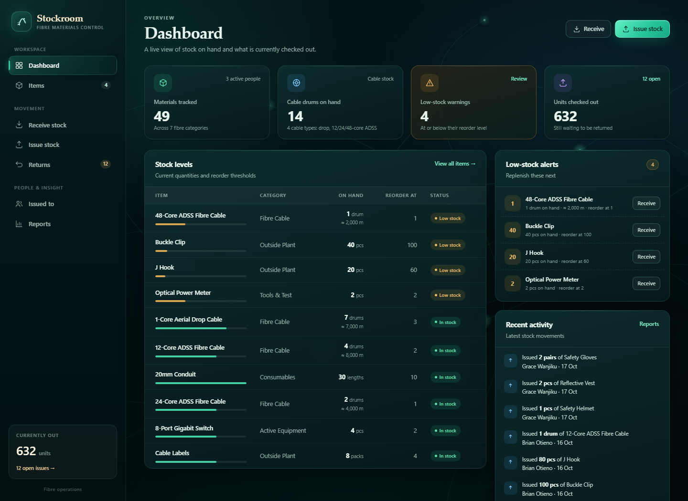

# Stockroom — Fibre Materials Control

A minimal check-in / check-out inventory system for a **fibre-optic company**, built with **FastAPI**, **Jinja2 HTML templates**, hand-written **CSS**, and **SQLite**. The interface uses a fibre-network backdrop with animated light pulses, cable-node accents, and a dark operations-console theme.

The seeded catalogue covers the materials a fibre ISP / contractor actually issues:

- **Fibre cable** — 1-core aerial drop, 12/24/48-core ADSS, counted in whole drums
- **Outside plant** — splice closures, ODF boxes, drop clamps, small/big tension clamps, UPBs, J hooks, buckle clips, cable ties
- **Passive components** — SC/APC fast connectors, pigtails, patch cords, PLC splitters, splice sleeves
- **Active equipment** — ONTs, ONT/WiFi, OLT, SFP modules, switches, routers, mini UPS
- **Tools & test** — fusion splicer, OTDR, power meter, VFL, cleaver, stripper, drill, harness
- **Consumables & safety** — alcohol, wipes, swabs, tape, heat-shrink, conduit, helmets, vests, gloves, first aid



## Screens

1. **Dashboard** — stock levels, low-stock warnings, cable-drum count and recent movement.
2. **Items** — add/edit materials and view the full stock history for one item.
3. **Receive stock** — log deliveries, with optional metres and serial numbers.
4. **Issue stock** — pick a person and add materials; stock is deducted automatically.
5. **Returns** — pick a past issue, mark quantities returned; stock is added back automatically.
6. **Issued to** — see what each person currently has outstanding; manage active people.
7. **Reports** — stock in/out over a date range plus a per-person issuance summary.

## Fibre-specific tracking

- **Cable is counted in whole drums.** Each cable item has a typical metres-per-drum value for an approximate metres-on-hand figure. Actual metres can be entered on any receipt or issue, because drums differ in length.
- **Serial numbers are optional.** Turn on “Track serial numbers” for ONTs, routers, tools or test gear. The receive/issue forms then show optional serial fields; they can be left blank when there are too many serials to enter by hand.
- **Stock adjustments** are available on every item page with a required reason.

## Run it

From this folder:

```powershell
.\.venv\Scripts\python.exe -m uvicorn main:app --reload --port 8000
```

Then open <http://127.0.0.1:8000>. You can also use the helper:

```powershell
.\run.ps1 -Port 8000
```

Fresh setup:

```powershell
python -m venv .venv
.\.venv\Scripts\python.exe -m pip install -r requirements.txt
.\.venv\Scripts\python.exe -m uvicorn main:app --reload
```

The SQLite database is created automatically at `data/stockroom.db` with a fibre demo dataset so every screen has content. Delete the database and restart to reseed.

## Deploy to a free server

`render.yaml` is included for a free **Render** web service. See [DEPLOY.md](DEPLOY.md) for the full walk-through (GitHub push, Blueprint deploy, health check, and free-tier caveats).

Render's free filesystem is ephemeral, so its SQLite data resets on restart or redeploy and reseeds the demo. That is fine for testing; use a persistent disk or hosted Postgres before storing real data.

## Data model

| Table | Fields |
| --- | --- |
| `items` | `id`, `name`, `category`, `unit`, `current_stock`, `reorder_level`, `metres_per_drum`, `tracks_serial` |
| `issued_to` | `id`, `name`, `phone`, `active` |
| `stock_in` | `id`, `item_id`, `quantity`, `source`, `date`, `metres`, `serial_numbers` |
| `issues` | `id`, `issued_to_id`, `date` |
| `issue_items` | `id`, `issue_id`, `item_id`, `quantity_issued`, `quantity_returned`, `returned_at`, `metres`, `serial_numbers` |
| `stock_adjustments` | `id`, `item_id`, `quantity_change`, `reason`, `date` |

Stock is written in the same transaction as each movement record, so `items.current_stock` stays consistent with the history.

## Project layout

```
stockroom/
├── main.py               FastAPI routes and page context
├── db.py                 Schema, migrations, fibre demo seed
├── run.ps1               One-command local runner
├── render.yaml           Free Render deployment blueprint
├── Procfile              Web process for other Python hosts
├── DEPLOY.md             Deployment walk-through
├── requirements.txt
├── data/                 SQLite database (created at runtime)
├── docs/dashboard.png    Screenshot
├── templates/            Jinja2 pages
├── static/style.css      Fibre-themed UI and responsive layout
└── static/app.js         Dynamic issue rows, optional metre/serial fields
```

## Notes

- An issue cannot exceed stock on hand; a return cannot exceed what is still outstanding.
- Deactivating a person blocks new issues but preserves their history and outstanding materials.
- Stock adjustments cannot take stock below zero.
- Low stock means `current_stock <= reorder_level`.
- The demo seed uses relative dates, so the dashboard and reports always show recent activity.
